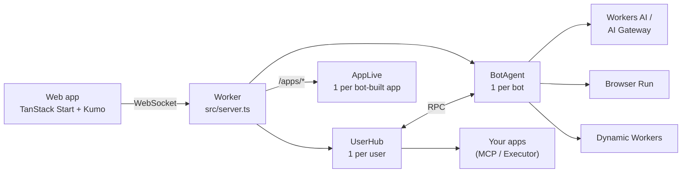
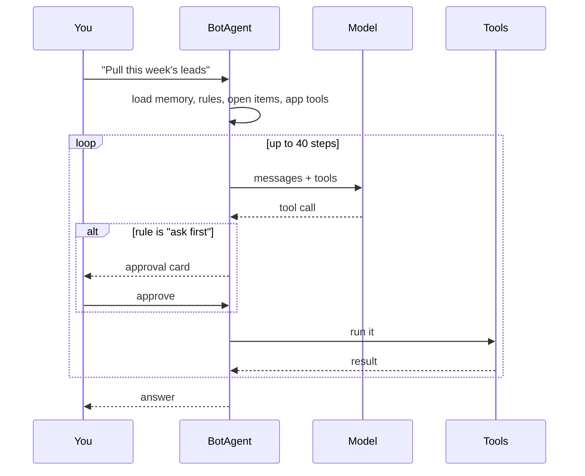
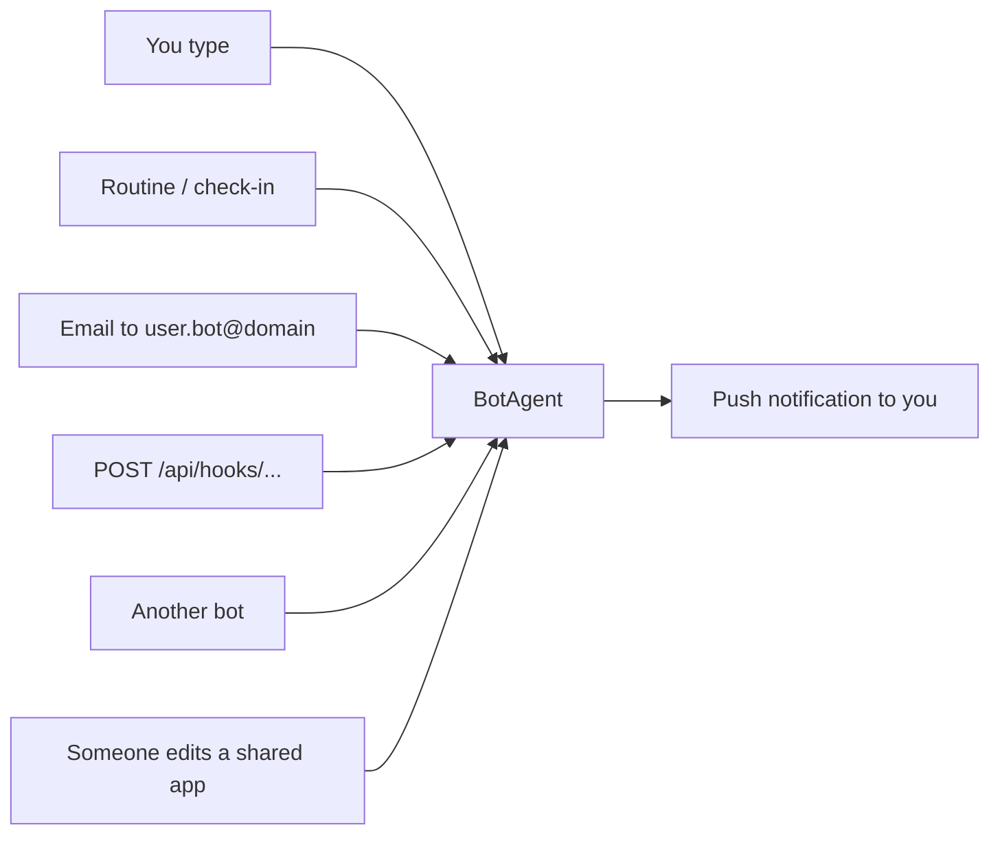

# 🤖 Coworkers

AI teammates that each get their own computer and browser. Built entirely on
Cloudflare.

You create bots, give each one a job, and they work for you, even when
you're away. They ask before doing anything risky. When one needs a login,
it hands you its browser.

> [!WARNING]
> Coworkers is still under heavy development and is experimental. Use it with
> caution.

> [!NOTE]
> `@cloudflare/think`, `@cloudflare/computer`, the `cf` CLI and the
> Cloudflare Vite plugin 2.0 are preview or beta. Expect breaking changes.

## The big picture

One Worker runs everything. There are three kinds of Durable Objects:



| Durable Object | What it owns                                                      |
| -------------- | ----------------------------------------------------------------- |
| `UserHub`      | Your bot list, app connections, shared memory, push subscriptions |
| `BotAgent`     | One bot: chat, memory, rules, routines, files, browser, secrets   |
| `AppLive`      | Live updates for a web app a bot built                            |

- Each bot keeps everything in its own SQLite. There's no separate database.
- You sign in to an app once, on the hub. Every bot uses that connection.
- The Worker only lets you reach your own hub and your own bots.

## What a bot can do

| Feature         | How it works                                                                                                                                                                       |
| --------------- | ---------------------------------------------------------------------------------------------------------------------------------------------------------------------------------- |
| Chat            | Streaming, resumable turns. Names itself from your first task                                                                                                                      |
| Computer        | Files in `/workspace`, a shell (`curl`, `jq`) and JavaScript scripts in Dynamic Workers. No container. Scripts survive deploys and can pause for your OK before touching your apps |
| Read the web    | Quick reads (markdown, extract, links, screenshot, PDF, crawl). Kitesurf first, Chromium fallback                                                                                  |
| Search the web  | Optional Parallel Search through AI Gateway, or a connected search MCP                                                                                                             |
| Drive a browser | A real Chromium session you can watch live                                                                                                                                         |
| Take over       | Bot hands you its browser to sign in. You click **I'm done**, it continues                                                                                                         |
| Your apps       | Calls tools on connected MCP servers or Executor                                                                                                                                   |
| Rules           | Per action type: allow, ask first, or block                                                                                                                                        |
| Routines        | Cron or one-off jobs. Can watch a URL/command and only wake when it changes                                                                                                        |
| Check-ins       | Wakes every few hours, speaks only if something's worth saying                                                                                                                     |
| Memory          | Its own memory + one shared across all your bots. Both have version history                                                                                                        |
| Open items      | Tracks things it's waiting on until they're resolved                                                                                                                               |
| Other bots      | Messages and files to other bots                                                                                                                                                   |
| Web apps        | Builds small sites (trackers, dashboards) on its own data, shareable by link                                                                                                       |
| Teach by demo   | Records you doing a task in its browser, saves it as a skill                                                                                                                       |
| Secrets         | You type an API key in a masked card. The bot uses it but never sees it                                                                                                            |
| Wake-ups        | Inbound email, webhooks, and push notifications to you                                                                                                                             |

## How a turn works



- A loop guard stops the bot from repeating the same call over and over.
- Unanswered approvals get a push reminder after 4 hours and close after 24.
- Background turns (routines, check-ins, email, webhooks) can use a cheaper
  model via `BACKGROUND_MODEL`.

## Rules

Each bot has one setting per action type:

| Action type        | Default   |
| ------------------ | --------- |
| Edit files         | allow     |
| Run commands       | allow     |
| Read the web       | allow     |
| Drive the browser  | allow     |
| Use connected apps | ask first |
| Message other bots | allow     |
| Schedule routines  | allow     |

Nobody is around to approve a background turn. So by default it can only use
app tools that are read-only.

## Ways to wake a bot



## Stack

| Layer      | What we use                                               |
| ---------- | --------------------------------------------------------- |
| Runtime    | Cloudflare Workers, Durable Objects (SQLite)              |
| Agents     | `agents` SDK, `@cloudflare/think`, `@cloudflare/computer` |
| Models     | Workers AI, or any provider through AI Gateway            |
| Browser    | Browser Run: Chromium, Live View, Kitesurf                |
| Sandboxing | Dynamic Workers (shell, scripts, bot-built app servers)   |
| Inbound    | Email Routing, webhooks, Web Push                         |
| Frontend   | TanStack Start, React 19, Tailwind v4, Kumo, Hugeicons    |
| Tooling    | `cf` CLI, Vite, Vitest, pnpm                              |

## Run it locally

```bash
npm i -g cf
```

```bash
pnpm install
```

```bash
npx wrangler login
```

```bash
pnpm dev
```

Then open http://localhost:3000.

- **Why Wrangler login?** Workers AI and Browser Run can't run locally, so dev
  calls your real account for those two. Everything else runs on disk under
  `.cloudflare/state/`.
- **More than one account?** Prefix with `CLOUDFLARE_ACCOUNT_ID=<id>`.
- **Secrets:** copy `.dev.vars.example` to `.dev.vars`. All of them are
  optional.

## Deploy

You need a Cloudflare account on the **Workers Paid** plan (Browser Run and
Dynamic Workers require it).

### Option A: the installer

Sign in with Cloudflare, pick a name, who can sign in and a model, and the
installer builds Coworkers into your account: the Worker, an AI Gateway, and
Cloudflare Access in front. Re-running it with the same name updates Coworkers
and keeps your bots. How it works and how to host it: [`installer/`](installer/README.md).

### Option B: one command

```bash
git clone https://github.com/fayazara/coworkers && cd coworkers
pnpm install
cf auth login
pnpm run setup
```

`scripts/setup.ts` asks for the account, a name, who can sign in and a model,
then does what the installer does with the `cf` CLI:

1. creates the AI Gateway and Web Push keys
2. deploys once with Access required but not yet set up, so the new URL
   refuses every request instead of being open
3. sets up Cloudflare Access: your allow list, plus a bypass for shared app
   links (`/apps`) and webhooks (`/api/hooks`), which carry their own tokens
4. deploys again with the Access application's AUD

Your choices go in `coworkers.deploy.json` and secrets in `.dev.vars.production`.
Both are git-ignored. **To update later:** `git pull`, then `pnpm run setup`
again. It remembers your answers, and bots and their data are kept.

Use `pnpm run setup`, not `pnpm setup` (a pnpm built-in). Add `-- --yes` to
skip the questions and reuse your saved answers, e.g. in CI.

<details>
<summary><strong>Option C: every step by hand</strong></summary>

The same result with the dashboard and `cf`, if you want to see each piece.
With more than one account, prefix `cf` commands with
`CLOUDFLARE_ACCOUNT_ID=<id>`.

**1. Create the AI Gateway**

```bash
cf ai-gateway gateways create --id coworkers --authentication --collect-logs \
  --cache-invalidate-on-update --cache-ttl 0 \
  --rate-limiting-interval 0 --rate-limiting-limit 0
```

**2. Write `coworkers.deploy.json`** in the repo root. Leaving out the Access
values deploys Coworkers open to everyone as the `demo` user, so start with
placeholders that lock it:

```json
{
  "name": "coworkers",
  "gateway": "coworkers",
  "accessTeamDomain": "locked.invalid",
  "accessAud": "locked"
}
```

**3. Secrets and the first deploy**

```bash
npx web-push generate-vapid-keys
cp .dev.vars.example .dev.vars.production   # paste both keys in
pnpm run deploy --secrets-file .dev.vars.production
```

Note the `https://<name>.<subdomain>.workers.dev` URL it prints. It answers
401 for now.

**4. Cloudflare Access.** In [Zero Trust](https://one.dash.cloudflare.com/)
(the free plan is enough):

1. **Access → Policies → Add a policy:** action **Allow**, include
   **Emails** for everyone who should get in.
2. **Add another policy:** action **Bypass**, include **Everyone**.
3. **Access → Applications → Add → Self-hosted:** public hostname = your
   Coworkers host, no path, with the Allow policy. Use a public hostname, not a
   Worker destination: Worker destinations refuse WebSocket upgrades.
4. **Add a second self-hosted application:** your host with path `apps`, and
   your host with path `api/hooks`, with the Bypass policy.
5. Copy the first application's **Application Audience (AUD) Tag** from its
   overview. Your team domain is on Zero Trust's **Settings** page.

**5. Unlock and deploy again.** Put the real values in `coworkers.deploy.json`:

```json
  "accessTeamDomain": "<team>.cloudflareaccess.com",
  "accessAud": "<aud tag>"
```

```bash
pnpm run deploy --secrets-file .dev.vars.production
```

</details>

Either way, Coworkers then checks the Access token on every request and answers
401 without a valid one, so it stays closed even if Access is turned off by
mistake. Each email gets its own bots.

### After deploying: models

Open **Models** (the brain icon at the bottom of the sidebar). Workers AI
models need nothing more. For Anthropic, OpenAI, Google or xAI, add
[Unified Billing](https://developers.cloudflare.com/ai-gateway/features/unified-billing/)
credits or your own provider key to the gateway, then press **Test**.

### Optional: web search

Bots can search for sources with [Parallel Search](https://docs.parallel.ai/search/search-quickstart).
Choose the built-in tool for deployment-wide access, or connect the Parallel
MCP for your own account.

**Built-in tool through AI Gateway**

1. Create a Parallel API key at [Parallel Platform](https://platform.parallel.ai).
2. Create a Cloudflare API token with **Account → AI Gateway → Run** for
   the account that hosts Coworkers. The token authorizes the proxy request,
   including when the gateway requires authentication.
3. Fill in both values in `.dev.vars` for local development, or in your
   production secrets file:

   ```dotenv
   PARALLEL_API_KEY="your-parallel-key"
   AI_GATEWAY_API_TOKEN="your-cloudflare-token"
   ```

4. Restart local dev, or upload the production secrets with
   `pnpm run deploy --secrets-file <PATH>`. Leave both values empty to keep
   the tool off. Existing deployments need no changes.

The tool uses the existing `AI_GATEWAY_ID` (or `default`) and the
[Parallel provider proxy](https://developers.cloudflare.com/ai-gateway/usage/providers/parallel/):
`/parallel/v1/search`. It uses the current v1 request format with `mode: "fast"`,
five results by default (up to ten), and a 20,000-character excerpt budget.
It skips the gateway cache, sets a 30-second request timeout, and returns
source URLs, titles, publication dates, excerpts and warnings. Long results
are saved in the bot's files with a preview and a path to read the rest.
This keeps source details available within the bot's context limit.
The gateway can still log
search queries and responses according to its settings. Search calls use your
Parallel account; model billing credits do not replace the Parallel key.

`web_search` follows the bot's **Read the web** rule, which defaults to
**Allow**. In routines and check-ins, **Allow** runs searches without approval;
**Ask** and **Block** prevent them. Browser tools remain available to read
pages or interact with sites. Deployment secrets serve all users and bots
on that deployment. They stay on the server and out of model context.

To check the setup, ask a bot to search for a recent Cloudflare announcement
and cite its sources. Confirm that `web_search` appears in the steps and
that a Parallel request appears in your gateway logs. Set **Read the web**
to **Block** and confirm that the bot cannot call the tool. Without either
secret, the tool is absent. An invalid key or token produces a credential
error; a rate limit produces an HTTP 429 message without an automatic retry.

**Parallel MCP through Connections**

No code change or deployment secret is needed for this route:

Open **Settings → Connections** and click **Connect** on the **Parallel** row
under **Quick connect**. One click adds web search and page reads without an
API key, with free access at lower rate limits. The connection then appears
under **Your connections**, where you can check its status, retry or remove it.
If you already connected an official Parallel MCP server, the shortcut is
hidden to avoid adding it twice.

For paid access with your own key, use **Add a connection** instead. Set the
name to **Parallel**, the URL to
`https://mcp.parallel.ai/mcp?tools=web_search,web_fetch`, and add the header
`Authorization` with value `Bearer YOUR_PARALLEL_API_KEY`. Remove an existing
free connection first if you want to replace it with your own key.

The connection is shared by your bots and uses the **Use connected apps**
rule. Read-only app tools can run in background turns unless that rule is
**Block**. MCP calls go directly to Parallel. See the
[Parallel MCP guide](https://docs.parallel.ai/integrations/mcp/quickstart)
for authentication and rate limits. Use either this connection or the
built-in tool unless you need both.

## Configuration

Set in `cloudflare.config.ts`. Everything has a working default.
`coworkers.deploy.json`, if present, overrides the name, `MODEL`,
`AI_GATEWAY_ID` and the two `ACCESS_*` values.

| Setting                  | What it does                                                                         |
| ------------------------ | ------------------------------------------------------------------------------------ |
| `MODEL`                  | Default chat model. `@cf/...` = Workers AI, `provider/model` = catalog               |
| `BACKGROUND_MODEL`       | Model for routines, check-ins and email. Empty = the chat model                      |
| `FALLBACK_MODEL`         | Workers AI model a turn retries on when a third-party model fails                    |
| `AI_GATEWAY_ID`          | Gateway for every model call. Empty = `default` (created on first use)               |
| `ACCESS_TEAM_DOMAIN`     | With `ACCESS_AUD`, require a valid Access token on every request                     |
| `ACCESS_AUD`             | The Access application's AUD tag                                                     |
| `QUICK_ACTION_ENGINE`    | `kitesurf` (cheaper) or `chromium` for quick page reads                              |
| `EMAIL_DOMAIN`           | Turns on inbound email. Each bot gets `<user>.<bot>@<domain>`                        |
| `BROWSER_RUN_ACCOUNT_ID` | With `BROWSER_RUN_API_TOKEN` (secret), turns on the crawl tool                       |
| `PARALLEL_API_KEY`       | With `AI_GATEWAY_API_TOKEN`, enables the built-in web search tool (both are secrets) |
| `AI_GATEWAY_API_TOKEN`   | Cloudflare token with AI Gateway Run permission, used by web search                  |
| `VAPID_*`                | Push notification keys (`npx web-push generate-vapid-keys`)                          |

The Models page overrides `MODEL` and `BACKGROUND_MODEL` for your account,
and each bot can pick its own chat model in its settings.

## Project layout

```
src/
  server.ts           Worker entry: auth, /agents/*, /apps/*, inbound email
  agents/
    user-hub.ts       one per user: bot list, connections, shared memory, push
    bot-agent.ts      one per bot: tools, rules, routines, computer, browser
    prompt.ts         the bot's system prompt
    web-tools.ts      quick web read tools
    search-tools.ts   optional Parallel web search through AI Gateway
    apps-runtime.ts   serves bot-built apps + AppLive
    app-store.ts      app data and share links
    teach.ts          records a demo in the browser
    secrets.ts        credentials the bot never sees
    guards.ts         stops runaway loops
    memory.ts         memory helpers
    models.ts         model factory: AI Gateway, fallback, log metadata
  routes/
    _app/             bot thread, computer + settings panels, connections, models
    api/hooks.*.ts    webhook endpoint
  components/         thread, Computer card, sidebar, panels
  lib/                shared types, server functions, React contexts
installer/            "Deploy to Cloudflare" wizard (its own Worker)
scripts/setup.ts      the same deploy, from your terminal with cf
cloudflare.config.ts  Worker config and bindings
AGENTS.md             read this first if you're an AI coding agent
```

## Scripts

| Command           | What it does                            |
| ----------------- | --------------------------------------- |
| `pnpm dev`        | Dev server on :3000, running on workerd |
| `pnpm build`      | Production build                        |
| `pnpm run setup`  | Deploy with AI Gateway + Access (asks)  |
| `pnpm run deploy` | Build and deploy                        |
| `pnpm test`       | Vitest                                  |
| `pnpm typecheck`  | Regenerate binding types, then `tsc`    |
| `pnpm format`     | Prettier                                |
